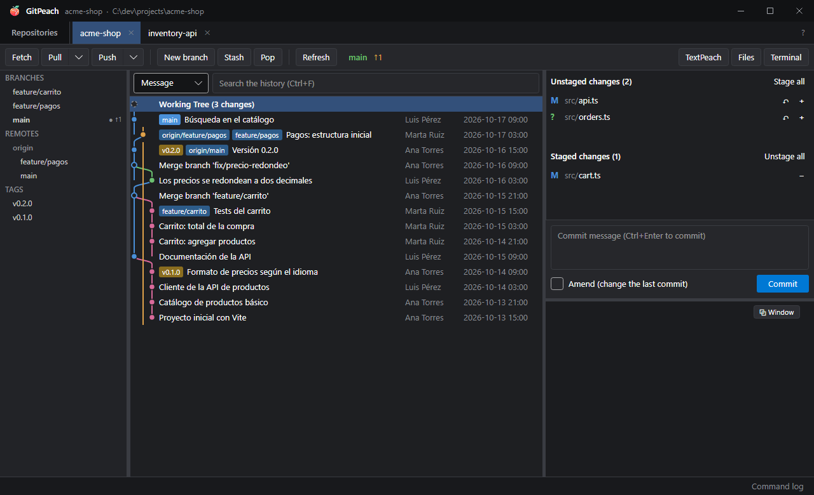
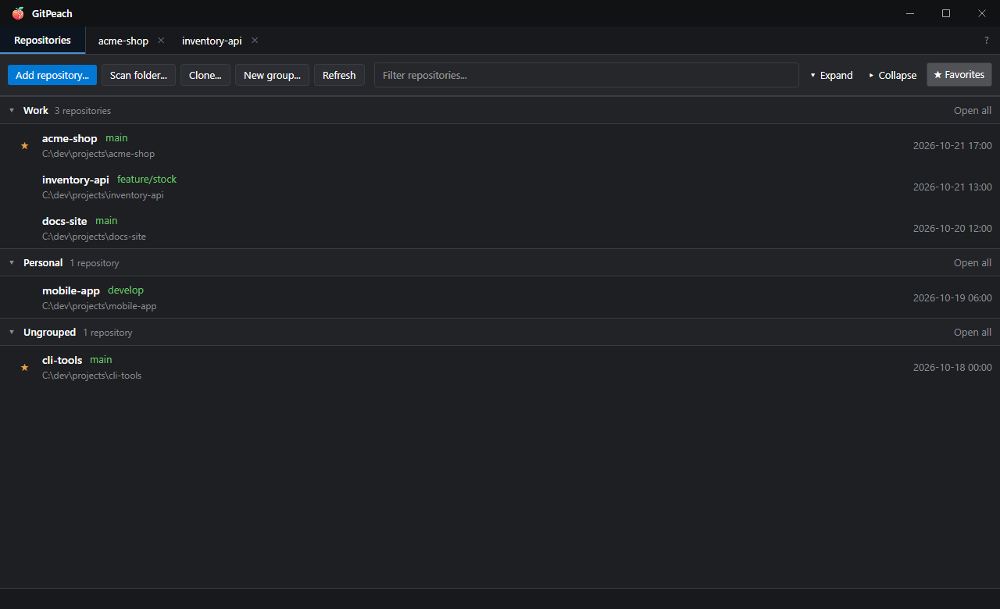
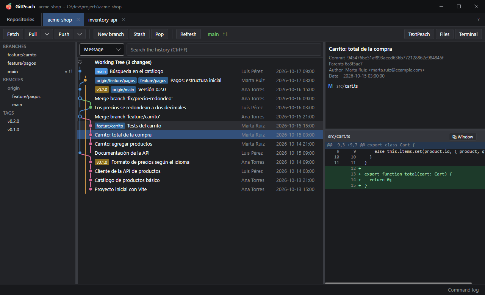
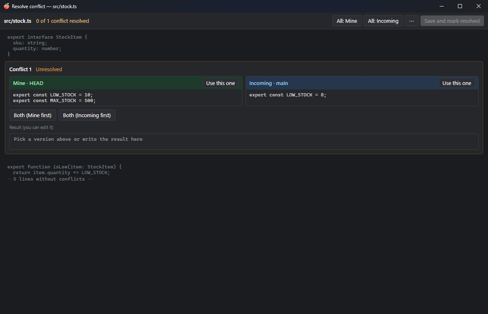
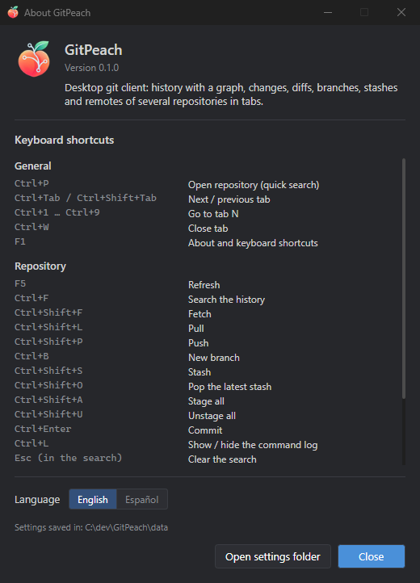

<p align="center">
  
</p>

<h1 align="center">GitPeach</h1>

<p align="center">
  A desktop git client for Windows and Linux.<br/>
  History with a graph, changes, diffs, branches, stashes and remotes of several repositories in tabs, with a
  sober interface that asks before anything that could lose work.
</p>

<p align="center">
  <a href="README.md">Español</a> · <b>English</b>
</p>

<p align="center">
  
</p>

---

## Contents

- [Why GitPeach?](#why-gitpeach)
- [Screenshots](#screenshots)
- [Features](#features)
- [Requirements](#requirements)
- [Installation](#installation)
- [Keyboard shortcuts](#keyboard-shortcuts)
- [Command line and integration](#command-line-and-integration)
- [Data and privacy](#data-and-privacy)
- [Building from source](#building-from-source)
- [Repository layout](#repository-layout)
- [Contributing](#contributing)
- [Versions and releases](#versions-and-releases)
- [License and credits](#license-and-credits)

---

## Why GitPeach?

GitPeach is the "git" half of the Peach family. [TextPeach](https://github.com/rileydev23/textpeach) shows the
code and its git state without touching anything; GitPeach is where the git work happens: staging, committing,
moving between branches, fetching and pushing.

- **It uses your git.** Every action is a real git command you can see in the **command log** (Ctrl+L), with its
  output. No custom formats, no hidden magic.
- **Destructive is never the default.** Discarding changes, hard reset, force push or deleting branches and tags
  ask first, and force push uses `--force-with-lease`.
- **Several repositories at once,** in tabs, organized in groups and favorites.
- **It refreshes on its own** when the repository changes on disk, even when another tool changes it.

It is a single portable executable (or an installer, if you prefer), with no accounts and no telemetry. In English and Spanish:
it follows the system language and can be switched in **About** (F1).

## Screenshots

| | |
|---|---|
|  |  |
| **Repositories:** groups, favorites and the current branch of each one. | **Commits:** author, date, parents, files and the diff of each one. |
|  |  |
| **Conflicts:** pick your version, the incoming one, both, or write the result. | **About (F1):** version, keyboard shortcuts, language and where the settings are kept. |

## Features

| Area | What it includes |
|---|---|
| **Repositories** | Persistent list with favorites ★, collapsible groups, filter, folder scan, clone, drag and drop of folders, quick open (Ctrl+P), several tabs restored on restart. |
| **History** | Commit list with a branch graph, paged loading and search by message, author, hash or code. |
| **Changes** | Staged and unstaged files, stage or discard per file or per hunk, commit and amend. |
| **Diffs** | Diff of the selected commit or of local changes, cached, and in a separate window. |
| **Branches, tags and remotes** | Create, rename, delete, checkout (remote branches too), merge, rebase, tags and pushing them, remote deletion. |
| **Fetch, pull and push** | Regular pull, with rebase or fast-forward only; push to another remote, push tags and force push with `--force-with-lease`. |
| **Commits** | Cherry-pick, revert, soft, mixed or hard reset to a commit, detached checkout, copy hash or message. |
| **Stashes** | Save, apply, pop and drop. |
| **Conflicts** | Built-in merge tool: pick yours, theirs, both, or edit the result. You can also open the configured external merge tool. Continue or abort merge, rebase and cherry-pick. |
| **Files** | A file's history (following renames), blame, read-only text viewer with optional editing (Ctrl+E), add to `.gitignore`. |
| **Integration** | Open the repository or a file in TextPeach, in the file manager or in a terminal; single instance so other apps can ask it to open repositories. |

## Requirements

- **To use it:** 64-bit Windows 10 or 11, or Linux x64 with a desktop (X11 or XWayland). No .NET installation
  needed (the executable is self-contained).
- **Git:** [Git for Windows](https://git-scm.com/download/win) or your distribution's `git`, on the `PATH`. For
  remotes with a user and password, GitPeach uses your git credential setup (for example, Git Credential
  Manager).
- **To build it:** [.NET 10 SDK](https://dotnet.microsoft.com/download).

## Installation

Download whichever you prefer from the repository's *Releases* (or build it, see
[Building from source](#building-from-source)):

- **Windows, installer:** `gitpeach-windows-x64-setup.exe`. It installs for your user only (no administrator) into
  `%LOCALAPPDATA%\Programs\GitPeach`, shows up in Start menu search and is uninstalled from
  **Settings > Apps**.
- **Windows, portable:** `gitpeach-windows-x64-portable.exe`. Put it in any folder and run it.
- **Linux:** `gitpeach-linux-x64.tar.gz`. Unpack it with `tar -xzf gitpeach-linux-x64.tar.gz` and run
  `./GitPeach`, or `./install.sh` to install it for your user (no root): it goes to `~/.local/opt/gitpeach`,
  with a `gitpeach` command and an entry in the app menu. To remove it, `~/.local/opt/gitpeach/uninstall.sh`.

*(Optional)* **Portable mode:** create an empty `portable.txt` file next to the executable and the data is kept
in `data/` beside it instead of in your profile. Uninstalling never deletes your data.

### Updates

Once a day, when it opens, GitPeach asks GitHub whether there is a new version. If there is, a **↑ 1.2.0**
button appears next to **?**; nothing else changes. Clicking it shows what is new and lets you choose
**Update and restart**, **Not now** or **Skip this version**. Updating checks the download against its SHA-256,
restarts GitPeach and reopens your tabs. If you used the installer, it updates by running the new installer
silently. In **About** (F1) you can turn the automatic check off or check right away.

## Keyboard shortcuts

They are also listed in **About** (F1).

| Shortcut | Action |
|---|---|
| `Ctrl+P` | Open a repository (quick search) |
| `Ctrl+Tab` / `Ctrl+Shift+Tab` | Next / previous tab |
| `Ctrl+1` … `Ctrl+9` | Go to tab N |
| `Ctrl+W` | Close tab |
| `F1` | About and keyboard shortcuts |
| `F5` | Refresh |
| `Ctrl+F` | Search the history |
| `Ctrl+Shift+F` / `Ctrl+Shift+L` / `Ctrl+Shift+P` | Fetch / Pull / Push |
| `Ctrl+B` | New branch |
| `Ctrl+Shift+S` / `Ctrl+Shift+O` | Stash / Pop the latest stash |
| `Ctrl+Shift+A` / `Ctrl+Shift+U` | Stage all / Unstage all |
| `Ctrl+Enter` | Commit |
| `Ctrl+L` | Show or hide the command log |
| `Ctrl+E` / `Ctrl+S` (in the viewer) | Edit / Save |

## Command line and integration

```
GitPeach.exe [repository] ...
```

- Each **repository** is added to the list (if it was not there) and opened in a tab.
- **Single instance:** if GitPeach is already running, the new launch hands it the paths over a local *named
  pipe* (current user only) and exits. That is how TextPeach can ask it to open a repository.
- **TextPeach:** the **TextPeach** button opens the repository to review the code read-only. TextPeach is looked
  up first where it said it runs from (`peachapps/TextPeach/location.json` in your user's data folder), then
  next to GitPeach, in a sibling `TextPeach` folder, in the usual install folders and on the `PATH`.

## Data and privacy

- GitPeach has **no telemetry and no accounts**. It only goes online through git, when you fetch, pull, push or
  clone, and only to your remotes.
  It also asks GitHub's public API for the latest GitPeach release, at most once a day (can be turned off in
  **About**), and downloads it only if you ask. It sends nothing about you.
- It keeps its state in `peachapps/GitPeach/state.json` inside your user's data folder (`%APPDATA%` on Windows,
  `~/.config` on Linux), or in `data/` next to the executable with `portable.txt`: the list of repositories and
  groups, open tabs and the window size. The exact path is shown in **About** (F1).

## Building from source

```bat
git clone https://github.com/rileydev23/gitpeach.git GitPeach
cd GitPeach

dev.cmd                       :: build in Debug and run
dotnet test GitPeach.sln      :: run the tests (they need git on the PATH)
build.cmd                     :: produce dist\GitPeach.exe (single-file, self-contained, win-x64)
```

On Linux, `./build.sh` produces `dist/GitPeach` (linux-x64). Both take an optional version (`build.cmd 0.4.0`)
that is stamped into the executable.

## Repository layout

```
GitPeach/
├── build.cmd · build.sh · dev.cmd · GitPeach.sln
├── docs/
│   ├── ARQUITECTURA.md      layers, MVVM + DI, conventions (in Spanish)
│   ├── DISENO.md            design system (colors, type, components, patterns; in Spanish)
│   └── img/                 screenshots with sample repositories (English ones in img/en/)
├── src/GitPeach/
│   ├── Git/                 GitRunner (the only place that runs git), GitRepository, pure parsers, graph
│   ├── Models/              commits, status, refs, diff, blame, options
│   ├── Services/            state, groups, disk watcher, single instance, shell, TextPeach
│   ├── ViewModels/          MVVM (CommunityToolkit.Mvvm)
│   └── Views/               Avalonia XAML, dialogs and secondary windows
└── tests/GitPeach.Tests/    xUnit: parsers, graph, diff, conflicts, groups and real temporary repos
```

## Contributing

Contributions are welcome! The full guide is in [CONTRIBUTING.md](CONTRIBUTING.md).

1. Open an *issue* describing the problem or the idea (with screenshots if it is visual).
2. *Fork* the repository, create a `feature/…`, `fix/…`, `docs/…`, `refactor/…` or `chore/…` branch and send
   a small, focused *pull request* against `main`.
3. Before sending it: `dotnet build` with no errors and `dotnet test` green.

## Versions and releases

GitPeach is at **0.x**: it is usable every day, but it can still change quite a bit. **1.0.0** will come once
the app is stable and has its final icon.

Versions follow [SemVer](https://semver.org) (`MAJOR.MINOR.PATCH`) and the repository uses *GitHub Flow*: a
single main branch, `main`, with no intermediate branches (`develop`, `release/…`).

```
feature/thing ──PR──┐
fix/other ─────PR───┼──▶ main ──(when the maintainer decides)──▶ release v0.4.0 (Windows + Linux)
docs/stuff ────PR───┘
```

1. **Every change lives in its own branch** (`feature/…`, `fix/…`, `docs/…`, `refactor/…`, `chore/…`) and
   reaches `main` through a reviewed *pull request* with green CI. Nobody pushes straight to `main`.
2. **Every merge updates a draft of the next release** with the notes grouped by kind. The version is worked
   out from the branches: any `feature/` raises the minor version (0.3.2 → 0.4.0), otherwise the patch
   (0.3.2 → 0.3.3).
3. **A merge is not a release.** Several pull requests can pile up in the draft, and it is published when
   there is something worth shipping. Publishing it creates the `vX.Y.Z` tag, and a workflow runs the tests,
   builds `gitpeach-windows-x64-portable.exe`, `gitpeach-windows-x64-setup.exe` and `gitpeach-linux-x64.tar.gz` with that version, checks that both start, and
   attaches them to the release.
4. While on 0.x, breaking changes also raise only the minor version. For **1.0.0**, the maintainer changes the
   draft's version by hand right before publishing it.

`main` must always build and pass the tests: every release is cut from it.

## License and credits

Copyright © 2026 [rileydev23](https://github.com/rileydev23). GitPeach is free software under the
**[GNU General Public License v3.0](LICENSE)** or later (GPL-3.0-or-later), the same license as the whole Peach
family. In short:

- **Use it for free, for anything**, companies and commercial use included.
- **You can study it, change it and share your version**, as long as it is GPLv3 too, with its source code
  available and the copyright notices kept. Nobody can take it and ship it as closed software.
- **Need a closed version** or to embed it in a proprietary product? Contact
  [rileydev23](https://github.com/rileydev23) for a commercial license.

**Name and logo:** the GPL covers the code, not the brand. "GitPeach" and its logo identify the official
version; if you publish a fork, give it another name and logo.

**About the icon:** the current icon was made with AI. If you would like to propose a better one, made by a
person, I am happy to change it! Open an *issue* with your proposal.

The binding text is the one in [LICENSE](LICENSE).

Built with:

- [Avalonia UI](https://avaloniaui.net/) (MIT)
- [AvaloniaEdit](https://github.com/AvaloniaUI/AvaloniaEdit) (MIT)
- [CommunityToolkit.Mvvm](https://github.com/CommunityToolkit/dotnet) (MIT)
- [Microsoft.Extensions.DependencyInjection](https://github.com/dotnet/runtime) (MIT)
- [Git](https://git-scm.com/) (GPL-2.0, the system installation is used; it is not bundled)
